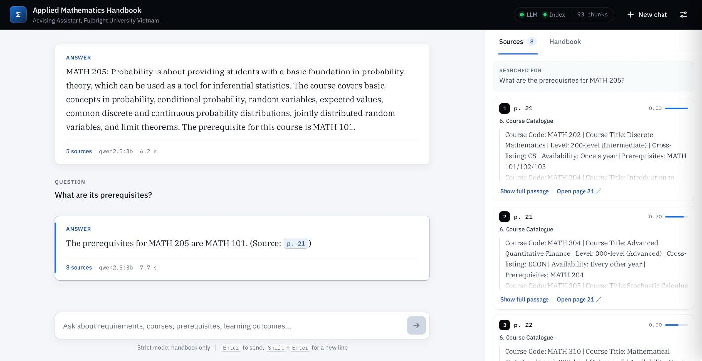
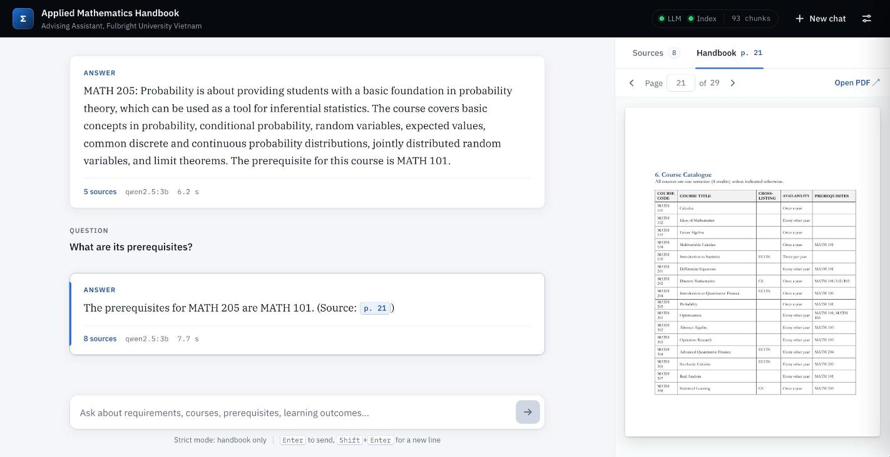
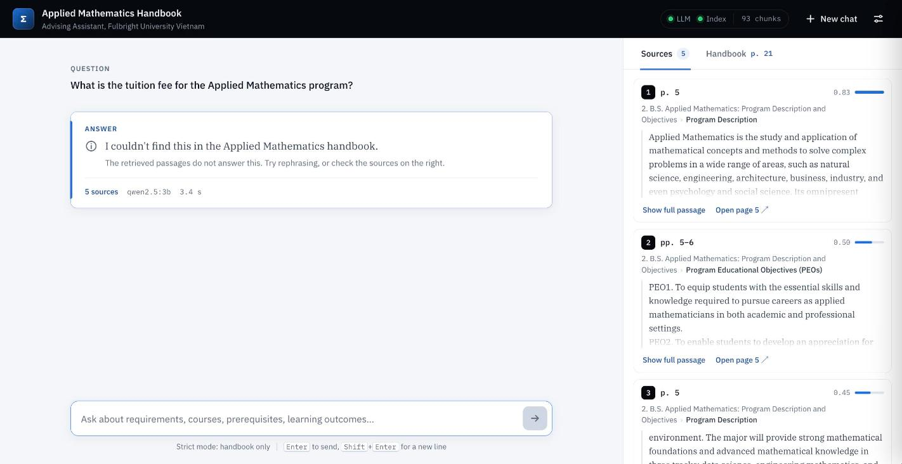

# Applied Mathematics Handbook Assistant

A fully **local** Retrieval-Augmented Generation (RAG) chatbot that answers questions about the Fulbright
University Vietnam **B.S. Applied Mathematics Major Handbook**, with page citations. Documents, embeddings,
the vector database and the language model all run on your machine; nothing is sent to a cloud API.

*CS311 Advanced Deep Learning, Fall 2026: final project.*



**Features:**

- **PDF support with OCR.** PyMuPDF / pymupdf4llm (or pypdf) extracts the text. Tesseract reads image-only pages,
  such as the program flowchart.
- **Structure-aware chunking.** One chunk per course description or requirement block, each prefixed with its
  section path. Tables are turned into one record per row.
- **Hybrid retrieval in Qdrant.** Dense (`nomic-embed-text`) and BM25 search, fused with Reciprocal Rank Fusion.
  The index is rebuilt automatically when the documents or the settings change.
- **Grounded answers.** A strict prompt with page citations and a fixed refusal when the handbook has no answer.
  Follow-up questions are rewritten into standalone queries.
- **Web UI.** Streaming answers, clickable citations, a sources panel and a viewer for the cited handbook page.
- **One-command Docker deployment.** Ollama, Qdrant, the FastAPI backend and an nginx web UI.

**Results** (45-question test set, manually reviewed, qwen2.5:3b): **0.77**, against 0.58 for a baseline-like
pipeline using the same model. Details are in the [report](report/report.pdf) and the
[evaluation analysis](source_code/eval/analysis.md).

---

## Contents

1. [Repository layout](#1-repository-layout)
2. [Quick start with Docker](#2-quick-start-with-docker)
3. [Local installation](#3-local-installation)
4. [Usage](#4-usage)
5. [Configuration](#5-configuration)
6. [Evaluation and tests](#6-evaluation-and-tests)
7. [How it works](#7-how-it-works)
8. [Troubleshooting](#8-troubleshooting)
9. [Project deliverables](#9-project-deliverables)

---

## 1. Repository layout

```
├── source_code/
│   ├── rag/                  # RAG core: config, loaders (PDF + OCR), chunking, index (Qdrant), prompts, chain, CLI
│   ├── api/main.py           # FastAPI backend (REST + Server-Sent Events)
│   ├── web/                  # web UI: static HTML/CSS/JS, bundled IBM Plex fonts
│   ├── eval/                 # test set (questions.yaml), runner, results, manual labels, analysis.md
│   ├── tests/                # unit tests (pytest)
│   ├── data/documents/       # documents to index: MATH_MajorHandbook.pdf
│   ├── config.yaml           # pipeline settings (every key can be overridden by an environment variable)
│   └── requirements.txt
├── docker/                   # Dockerfiles, docker-compose.yml, host-Ollama override, nginx.conf, deployment guide
├── report/                   # report.md, report.pdf, build.sh
├── demo_video/               # demo video links
├── docs/                     # SPECIFICATION.md (design options and decisions), screenshots/
└── .env.example              # environment variables for local runs
```

## 2. Quick start with Docker

**Requirements:**

- Docker Desktop 4.x (macOS/Windows), or Docker Engine 24+ with Compose v2.20+ (Linux);
- about 8 GB of RAM available to Docker and 6 GB of free disk.

```bash
git clone https://github.com/amyas-lab/Document-RAG-for-FUV.git
cd Document-RAG-for-FUV/docker
docker compose up --build -d
```

The first start takes 5–10 minutes. Docker builds the images, `ollama-init` pulls `qwen2.5:3b` and
`nomic-embed-text` (about 2.3 GB), and the API indexes the handbook. You can follow the progress with
`docker compose logs -f ollama-init api`.

| Service | URL |
|---|---|
| Web UI | <http://localhost:8080> |
| API docs (Swagger) | <http://localhost:8000/docs> |
| Qdrant dashboard | <http://localhost:6333/dashboard> |

**Faster on Apple Silicon.** Docker on macOS cannot use the Metal GPU, so the bundled Ollama runs on CPU (about
38 s per answer on an M2). To use Ollama installed on the host instead (about 5–14 s per answer):

```bash
ollama pull qwen2.5:3b && ollama pull nomic-embed-text      # on the host
docker compose -f docker-compose.yml -f docker-compose.host-ollama.yml up --build -d
```

**Stop and clean up:**

```bash
docker compose down        # keeps the index and models
docker compose down -v     # also removes them
```

See [`docker/README.md`](docker/README.md) for configuration, tests and troubleshooting.

## 3. Local installation

**Prerequisites:**

- Python **3.11** (some dependencies do not support 3.13+ yet);
- [Ollama](https://ollama.com);
- Tesseract, used for OCR of image-only pages:
  - macOS: `brew install ollama tesseract`;
  - Ubuntu/Debian: `sudo apt install tesseract-ocr`, plus the Linux installer from ollama.com.

```bash
git clone https://github.com/amyas-lab/Document-RAG-for-FUV.git
cd Document-RAG-for-FUV

# Python environment (conda or venv)
conda create -n rag python=3.11 -y && conda activate rag
pip install -r source_code/requirements.txt

# Models (Ollama must be running: `ollama serve`, or the desktop app / brew service)
ollama pull qwen2.5:3b
ollama pull nomic-embed-text

# Optional: local settings
cp .env.example .env
```

Every command below runs from `source_code/`. Without `QDRANT_URL`, Qdrant runs in **embedded mode**: the index is a
folder under `data/`, and no server is needed.

## 4. Usage

### Command line

```bash
cd source_code
python -m rag.cli index                      # build the index (skipped if it is up to date; --reindex forces it)
python -m rag.cli ask -q "What are the prerequisites for MATH 305?"
python -m rag.cli ask -q "How often is MATH 301 offered?" --show-context
python -m rag.cli chat                       # multi-turn conversation in the terminal
```

Inspection tools, mostly for Task 1:

```bash
python -m rag.cli extract                    # write the extracted text of each page to data/extracted/
python -m rag.cli chunks --page 14 --full    # show the chunks of page 14 (OCR of the flowchart)
python -m rag.cli chunks --grep "MATH 305"
```

Global options apply to every subcommand and are written before it, for example
`python -m rag.cli --model qwen2.5:1.5b --mode fallback -k 8 ask -q "..."`:

| Option | Values |
|---|---|
| `--parser` | `pypdf`, `pymupdf` |
| `--chunking` | `fixed`, `structure` |
| `--retrieval` | `hybrid`, `dense` |
| `--model`, `--embed` | any Ollama model |
| `--mode` | `strict`, `fallback` |
| `-k` | number of passages |

### API and web UI

```bash
cd source_code
uvicorn api.main:app --port 8000
# API docs: http://localhost:8000/docs     Web UI: http://localhost:8000/ui/
```

| Method | Endpoint | Purpose |
|---|---|---|
| `GET` | `/health` | Ollama and Qdrant status, number of indexed chunks, default settings |
| `GET` | `/models` | Installed Ollama chat models |
| `POST` | `/chat` | Ask a question; returns the answer, sources, rewritten query and latency |
| `POST` | `/chat/stream` | Same, as Server-Sent Events: `sources`, then `token` events, then `done` |
| `POST` | `/index` | Re-index `data/documents` (`{"force": true}` rebuilds unconditionally) |
| `GET` | `/documents`, `/documents/{name}`, `/documents/{name}/pages/{n}.png` | Indexed files, the file itself, a rendered page |

```bash
curl -s -X POST localhost:8000/chat -H 'Content-Type: application/json' -d '{
  "question": "What are its prerequisites?",
  "history": [{"role": "user", "content": "What is MATH 205 about?"},
              {"role": "assistant", "content": "MATH 205 Probability covers ..."}]
}'
```

The request body also accepts `model`, `top_k`, `temperature` and `mode` (`strict` or `fallback`).

**In the web UI:**

- Click a page chip such as `p. 21` to highlight the passage it refers to.
- Use **Open page** to see the handbook page itself.
- Use **New chat** to start over.
- The settings button (top right) changes the model, answer mode, number of passages, temperature and appearance.

| | |
|---|---|
|  |  |

### Adding documents

Put `.pdf` or `.txt` files in `source_code/data/documents/` and then run `python -m rag.cli index`, call
`POST /index`, or restart the API. The index stores a hash of the documents and settings, so it is rebuilt only when
something changed.

## 5. Configuration

Settings live in [`source_code/config.yaml`](source_code/config.yaml). Any key can be overridden by an
environment variable with the same name in upper case, in the shell, in `.env` or in Docker Compose.

| Variable | Default | Meaning |
|---|---|---|
| `LLM_MODEL` | `qwen2.5:3b` | Ollama chat model |
| `EMBED_MODEL` | `nomic-embed-text` | Ollama embedding model (a new one gets its own collection) |
| `OLLAMA_URL` | `http://127.0.0.1:11434` | Ollama server |
| `QDRANT_URL` | empty | Qdrant server (e.g. `http://localhost:6333`). Empty means embedded mode |
| `QDRANT_PATH` | `data/qdrant_local` | Folder for embedded mode |
| `PDF_PARSER` | `pymupdf` | `pymupdf` (Markdown, tables) or `pypdf` (baseline) |
| `CHUNKING` | `structure` | `structure` (heading-aware) or `fixed` (baseline splitter) |
| `RETRIEVAL_MODE` | `hybrid` | `hybrid` (dense + BM25) or `dense` |
| `TOP_K` | `5` | Passages per answer (follow-up questions get 3 more) |
| `PROMPT_MODE` | `strict` | `strict` (handbook only, with citations) or `fallback` (baseline prompt) |
| `TEMPERATURE` | `0.1` | Generation temperature |
| `OCR_ENABLED` | `true` | OCR pages with fewer than `OCR_MIN_CHARS` characters of text |

## 6. Evaluation and tests

```bash
cd source_code
pytest -q tests                                        # 11 offline tests (parsing, OCR, chunking, metrics)
python -m eval.run_eval answers --models qwen2.5:3b    # answer the 45 test questions
python -m eval.run_eval retrieval                      # retrieval ablation grid (no LLM)
python -m eval.run_eval report                         # write eval/results/summary.md
bash eval/run_all.sh                                   # every experiment (about 1 h on an M2)
```

The test set ([`eval/questions.yaml`](source_code/eval/questions.yaml)) has 45 questions:

- 38 answerable (including 3 multi-turn);
- 4 ambiguous, where the handbook contradicts itself;
- 3 out of scope.

Each question has gold pages and key facts. The runner reports retrieval metrics (Hit@k, MRR, context recall) and
labels each answer. Corrections from the manual review are in
[`eval/manual_labels.yaml`](source_code/eval/manual_labels.yaml).

| Configuration (qwen2.5:3b, strict prompt) | Correct | Incorrect | False refusal | Score |
|---|---|---|---|---|
| Baseline-like: pypdf, fixed chunks, dense | 19 | 8 | 7 | 0.58 |
| Improved retrieval (round 2) | 27 | 6 | 3 | 0.73 |
| **Deployed (round 3)** | **29** | 6 | 2 | **0.77** |

Model and prompt comparisons, the retrieval ablation and the error analysis are in
[`eval/analysis.md`](source_code/eval/analysis.md).

## 7. How it works

```
PDF ─► PyMuPDF / pymupdf4llm ─► clean ─► Tesseract OCR (image-only pages) ─► structure-aware chunker
    ─► nomic-embed-text (dense) + BM25 (sparse) ─► Qdrant

question + history ─► query rewriting ─► hybrid search (RRF) ─► top-k passages with page numbers
    ─► strict prompt ─► qwen2.5:3b (Ollama) ─► answer with citations ─► FastAPI (SSE) ─► web UI
```

The [report](report/report.pdf) explains the design choices, the three evaluation rounds and the known limitations.
The options considered for each component (vector database, PDF parser, UI framework, Docker topology) are
in [`docs/SPECIFICATION.md`](docs/SPECIFICATION.md).

## 8. Troubleshooting

| Problem | Fix |
|---|---|
| `Connection refused` to Ollama | Start Ollama (`ollama serve` or the desktop app) and check `OLLAMA_URL` |
| `model "…" not found` | `ollama pull <model>`; in Docker, add it to `EXTRA_MODELS` |
| `Storage folder … is already accessed by another instance of Qdrant` | Embedded Qdrant allows one process at a time. Stop the other process (for example a running `rag.cli chat`), or set `QDRANT_PATH` to another folder |
| Page 14 (flowchart) has no text | Install Tesseract (`tesseract --version`) and re-index with `python -m rag.cli index --reindex` |
| Answers are slow in Docker on a Mac | Use the host-Ollama override (Section 2) |
| `pip install` fails on Python 3.13+ | Use Python 3.11 |

## 9. Project deliverables

| Task | Where |
|---|---|
| 1. PDF support | [`rag/loaders.py`](source_code/rag/loaders.py), [`rag/chunking.py`](source_code/rag/chunking.py), `rag.cli extract / chunks` |
| 2. Handbook chatbot and evaluation | [`source_code/eval/`](source_code/eval/), [`analysis.md`](source_code/eval/analysis.md) |
| 3. Docker deployment | [`docker/`](docker/), [`docker/README.md`](docker/README.md) |
| 4. Web UI | [`source_code/web/`](source_code/web/), [`source_code/api/`](source_code/api/), [`docs/screenshots/`](docs/screenshots/) |
| 5. Report | [`report/report.pdf`](report/report.pdf) (source: [`report.md`](report/report.md)) |
| 6. Demo videos | [`demo_video/`](demo_video/) |
| 7. Repository and README | this file |

**Acknowledgements.**

- Baseline code and handbook: CS311 course materials.
- Fonts: IBM Plex (SIL Open Font License, [`web/fonts/OFL.txt`](source_code/web/fonts/OFL.txt)).
