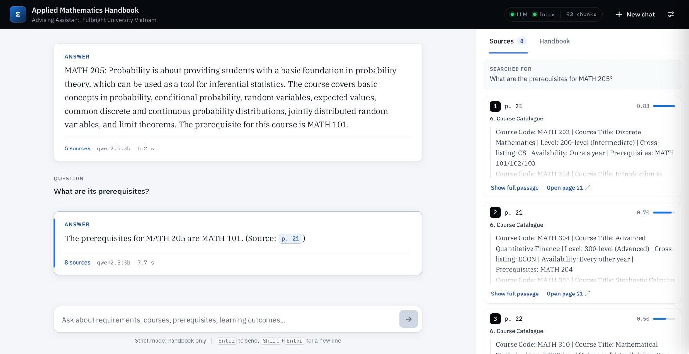
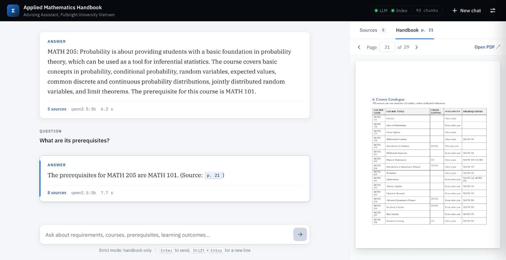
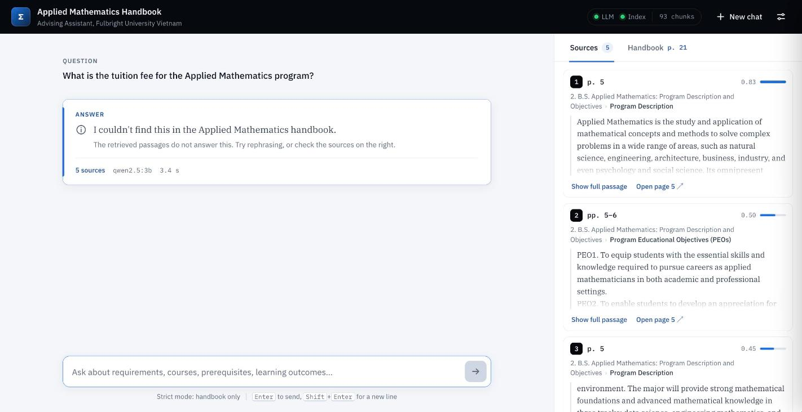
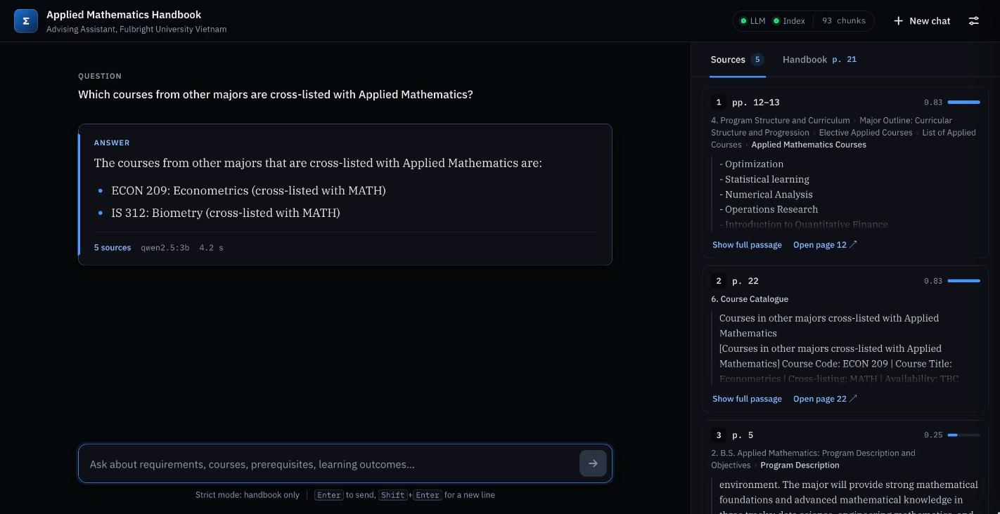

# FUV Handbook RAG: Design Specification

> **Design specification.** This document was written before implementation, to explore the options and
> record the decisions (§6, Decision Log). It is kept for reference and updated with what was built.
> For installation and usage, see the [README](../README.md); for results, see the [report](../report/report.pdf).


> CS311 Advanced Deep Learning — Final Project (Fall 2026)
> A fully **local** RAG system (no cloud APIs) that answers questions about the
> Fulbright University Vietnam **B.S. Applied Mathematics Major Handbook** (v1.0, Sep 2025),
> packaged with Docker and served through a web UI.

**Status:** 🚧 In progress. ✅ Task 1 (PDF support, OCR, Qdrant hybrid index, CLI) · ✅ Task 2 (evaluation, see [`source_code/eval/analysis.md`](../source_code/eval/analysis.md)) · ✅ Task 3 (Docker) · ✅ Task 4 (FastAPI + web UI) · ✅ Task 5 ([report](../report/report.pdf)) · ⏳ Tasks 6–7.

**Stack at a glance:** PyMuPDF/pypdf + Tesseract OCR → structure-aware chunking → Ollama embeddings →
**Qdrant** (hybrid dense + BM25) → Ollama LLM → **FastAPI** backend → **web UI** (static HTML/CSS/JS served by nginx),
all orchestrated with **Docker Compose** (fully containerised, or with a host-Ollama override).

| Answer with sources and a follow-up question | Cited handbook page |
|---|---|
|  |  |
| **Out-of-scope question (refusal)** | **Dark mode** |
|  |  |

More in [`docs/screenshots/`](screenshots/): welcome screen, settings.

---

## Table of Contents
1. [Project Goals](#1-project-goals)
2. [Baseline Analysis](#2-baseline-analysis-sample_coderun_txtpy)
3. [Knowledge Source: MATH Handbook Profile](#3-knowledge-source-math-handbook-profile)
4. [System Architecture](#4-system-architecture)
5. [Task Specifications (1–7)](#5-task-specifications)
6. [Design Options & Recommendations](#6-design-options--recommendations)
7. [Evaluation Plan](#7-evaluation-plan)
8. [Repository Layout](#8-repository-layout)
9. [Installation & Usage (target)](#9-installation--usage-target)
10. [Decision Log](#10-decision-log)
11. [Known Limitations](#11-known-limitations)
12. [Milestones](#12-milestones)

---

## 1. Project Goals

| # | Task | Weight | Deliverables |
|---|------|--------|--------------|
| 1 | PDF file support | 5% | Modified source code; demo of PDF retrieval |
| 2 | Major handbook chatbot (**Applied Mathematics**) | 15% | Working chatbot; test questions + results; performance analysis |
| 3 | Docker container deployment | 20% | Dockerfile; container config (compose); deployment instructions |
| 4 | UI/UX deployment | 20% | Web interface; backend integration; screenshots |
| 5 | Report (≥ 1,500 words) | 15% | PDF report |
| 6 | Video demos (Tasks 1–4) | 20% | 4 videos (5% each) |
| 7 | GitHub repository + README | 5% | This repository |

**Non-functional requirements**
- **Local-only:** documents, embeddings, vector DB and LLM all run on the user's machine (Ollama).
- **Reproducible:** one-command startup via Docker Compose. Models and the index persist in volumes.
- **Transparent:** every answer shows the retrieved sources (page and section) so that it can be checked.
- **Dev machine:** Apple M2, 16 GB RAM, macOS. **Target runtime:** macOS and Linux.

---

## 2. Baseline Analysis (`sample_code/run_txt.py`)

| Aspect | Baseline behaviour | Problem for the handbook use case | Planned change |
|---|---|---|---|
| Loader | `*.txt` only | Handbook is a PDF | PDF loader with per-page metadata (Task 1) |
| Chunking | `RecursiveCharacterTextSplitter(1000, 200)` | Cuts through course entries and tables. No section info | Structure-aware chunking with `page`, `section`, `course_code` metadata |
| Embeddings | `nomic-embed-text` (Ollama), no task prefixes | nomic expects `search_query:` / `search_document:` prefixes | Add prefixes. Compare against one alternative model |
| Vector store | Chroma, persisted under `data_txt/vector_store` | Re-index only happens when the folder is missing. No change detection. Dense-only search misses exact course codes | **Qdrant** with hybrid dense + sparse (BM25) search. Content hash → automatic re-index when documents change |
| Score | `1/(1+L2 distance)`, averaged over top-K, threshold 0.3 | Mean score is a weak signal. Threshold not calibrated | Cosine space. Threshold calibrated on the test set |
| Prompt | Falls back to **general knowledge** when context is weak | Leads to hallucinated policies and requirements | **Strict grounding:** answer only from context, otherwise say "not found in the handbook". Cite pages |
| LLM | `qwen2.5:0.5b`, temperature 0.7 | Too small and too random for factual QA | Larger model, temperature 0–0.2. Compare models |
| Config | Hard-coded constants | Not Docker-friendly | `config.yaml` + environment-variable overrides (`OLLAMA_URL`, `LLM_MODEL`, …) |
| Interface | One-shot CLI | No conversation history | CLI + web UI with chat history |
| Requirements | Includes `torch`, `sentence-transformers`, `unstructured`, `ragas` | About 2+ GB of unused dependencies in the Docker image | Slim `requirements.txt`. Heavy extras become optional |

---

## 3. Knowledge Source: MATH Handbook Profile

`final-project/sample_code/major_handbook_pdfs/MATH_MajorHandbook.pdf`: 29 pages, ~7,700 words,
exported from Word, with a selectable text layer (tagged PDF).

| Section (TOC) | Pages | Content type | RAG challenge |
|---|---|---|---|
| Cover + Table of Contents | 1–2 | Dot-leader lines | Noise chunks ("MATH 301: Optimization …… 24") pollute retrieval. **Strip them** |
| 1. Mission, Vision, Graduate Attributes (GA1–GA10) | 3 | Prose + list | Generic FUV text that is shared across all handbooks |
| 2. Program Description, PEOs, PLOs (CoreLO 1–5, MLO 1–5) | 4–5 | Prose + 2 tables | Table rows wrap across several lines |
| 3. Graduate Studies & Career Paths | 5–7 | Lists | Easy |
| 4. Program Structure: degree requirements (40 + 56 credits, 128 total), minor (24 credits), course tiers, elective applied list | 8–13 | Numbered lists, nested lists | **Most-asked questions.** Numbers must be exact |
| — Applied Mathematics **Flowchart** | 14 | **Full-page image, no text layer** | Invisible without OCR (Assignment FAQ #5) |
| — Sample Student Journeys (Model A / B / Minor) | 15 | 4-column year grid | Columns interleave when extracted as text |
| — Course ↔ MLO alignment matrix (I/R/M/A) | 16–17 | Dense matrix | Hard for small LLMs to read |
| 5. Teaching, Learning & Assessment | 17–20 | Prose (accreditation style) | Long, repetitive |
| 6. Course Catalogue table (availability, cross-listing, prerequisites) | 21–22 | Table. Course codes split across lines ("MATH\n101") | Prerequisite questions depend on the table parse |
| — Course Descriptions (MATH 101 … 311) | 21–28 | One entry per course | Ideal unit for one chunk per course |

**Inconsistencies inside the handbook.** These are good candidates for the "ambiguous" test cases:
- Elective applied courses: "at least one at **200-level** or higher" (Degree Requirements, item 9) vs. "at least one at **300 level**" (Major Outline) vs. flowchart "at least 1 at 300-level".
- **MATH 306** is "Financial Mathematics" in the TOC and course descriptions, but "Numerical Analysis" in the MLO matrix. Numerical Analysis is **MATH 313** in the catalogue.
- The General Curriculum requirements apply only to students who matriculated in **Fall 2024 or later** (footnote).

---

## 4. System Architecture

```
                    ┌──────────────── Indexing (offline / on change) ────────────────┐
 PDF / TXT files ──►│ Loader ─► Cleaner ─► (OCR for image-only pages) ─► Chunker ─►   │
 data/documents/    │ Embedder (Ollama) ─► Qdrant (dense + sparse, volume)           │
                    └─────────────────────────────────────────────────────────────────┘

                    ┌──────────────── Query (online) ────────────────────────────────┐
 User ─► Web UI ───►│ Backend: history-aware query ─► Qdrant hybrid retriever (top-K)  │
   ▲                │ ─► Prompt builder (strict grounding + citations) ─► LLM (Ollama)│
   └── answer + ────┤ ─► Answer + sources (page, section, score) + latency           │
       sources      └─────────────────────────────────────────────────────────────────┘
```

**Core module (`rag/`)** is shared by the CLI, API, UI and evaluation scripts:

| Module | Responsibility |
|---|---|
| `config.py` | Load `config.yaml` and apply env-var overrides |
| `loaders.py` | `.txt` / `.pdf` → `Document(page_content, metadata={source, page, section})` |
| `cleaning.py` | Strip TOC / dot leaders, headers and footers. Normalise whitespace and ligatures |
| `ocr.py` | Detect pages with no text layer → OCR (optional dependency) |
| `chunking.py` | Strategy A: fixed recursive (baseline). Strategy B: structure-aware (sections + one chunk per course) |
| `index.py` | Create the Qdrant collection (named dense vector + sparse BM25 vector, cosine), upsert points with payload `{source, page, section, course_code, text, doc_hash}`, incremental refresh by content hash |
| `retriever.py` | Hybrid query (dense + sparse, fused with RRF), optional payload filter (e.g. `course_code`), score threshold |
| `prompts.py` | System prompt, grounded QA prompt, query-rewrite prompt (for follow-ups) |
| `chain.py` | `answer(question, history) -> {answer, sources, used_context, latency}` (streaming variant included) |

---

## 5. Task Specifications

### Task 1 — PDF file support
- **F1.1** `loaders.py` loads every `*.pdf` and `*.txt` in `DATA_DIR` (recursively).
- **F1.2** Text is extracted **per page**. `metadata.page` (1-based) and `metadata.source` are kept so answers can cite pages.
- **F1.3** Cleaning removes TOC dot leaders, repeated headers and footers, and hyphenation artifacts.
- **F1.4** Pages whose text layer has fewer than N characters are flagged and handled by OCR (if enabled) or logged as skipped.
- **F1.5** Chunk → embed → upsert into Qdrant. Re-indexing is triggered automatically when a file's SHA-256 changes. `--reindex` forces a rebuild.
- **F1.6** CLI: `python -m rag.cli index` / `python -m rag.cli ask -q "..."`.
- **Acceptance:** a question whose answer exists only in a test PDF (e.g. a short arbitrary PDF) is answered correctly and the correct page is cited.

### Task 2 — Applied Mathematics handbook chatbot
- **F2.1** Knowledge source: `MATH_MajorHandbook.pdf` only. Collection name `math_handbook`.
- **F2.2** The chatbot covers program requirements, course offerings, prerequisites, learning outcomes and academic policies.
- **F2.3** Strict grounding. If the answer is not in the retrieved context, it replies *"I couldn't find this in the Applied Mathematics handbook."* The baseline fallback prompt is kept as an experiment arm.
- **F2.4** Multi-turn: follow-up questions ("what are its prerequisites?") are rewritten into standalone queries using the chat history before retrieval.
- **F2.5** Test set: `eval/questions.yaml` with ≥ 30 questions (see §7).
- **F2.6** Experiments: at least two chunking strategies × two embedding models × three or more LLMs. Results go to `eval/results/*.csv`, and the analysis goes to the report.
- **Acceptance:** an evaluation run produces a results table and labelled examples of correct, incorrect, incomplete and ambiguous answers.

### Task 3 — Docker deployment
- **F3.1** `docker/Dockerfile.api` and `docker/Dockerfile.ui`: `python:3.11-slim`, non-root user, `HEALTHCHECK`. The UI image has no ML dependencies; the BM25 model is baked into the API image.
- **F3.2** `docker/docker-compose.yml` defines the services (see §6.5). One command: `docker compose up --build`.
- **F3.3** Volumes: `./data/documents` → `/app/data/documents` (read-only), `qdrant_storage` → `/qdrant/storage` (named volume), `ollama_models` → `/root/.ollama` (named volume).
- **F3.4** Configuration via `.env` (`LLM_MODEL`, `EMBED_MODEL`, `OLLAMA_URL`, `TOP_K`, …). `.env.example` is committed.
- **F3.5** An init step pulls the required Ollama models on first start (`ollama pull`), then builds the index if it is missing.
- **F3.6** `docker/README.md` documents the full build → run → test → stop → clean-up sequence for macOS and Linux.
- **F3.7** Services and ports: `ollama` :11434, `qdrant` :6333 (REST + dashboard at `/dashboard`), `api` :8000 (Swagger at `/docs`), `ui` :8080 (nginx, proxies `/api`). Startup order is enforced with `depends_on: condition: service_healthy`.
- **Acceptance:** on a clean machine with only Docker installed, `docker compose up` gives a working chatbot at `http://localhost:8080`, the API at `http://localhost:8000/docs` and the Qdrant dashboard at `http://localhost:6333/dashboard`.

### Task 4 — Web UI
- **F4.1** Chat interface: question input, Markdown-rendered answers, streaming tokens.
- **F4.2** Conversation history within a session, plus a "New chat" button.
- **F4.3** A **Sources** panel for each answer: page, section, similarity score and an expandable chunk text.
- **F4.4** Sidebar settings: LLM model selector (from installed Ollama models), top-K, temperature, strict / fallback mode.
- **F4.5** Status indicators: Ollama reachable, index size (number of chunks), response latency.
- **F4.6** Example-question chips for first-time users.
- **F4.7** (Optional, useful for the Task 1 demo) Upload a PDF → index it into a temporary collection. *(not implemented)*
- **F4.8** Clicking a page citation highlights the passage and shows the rendered handbook page next to the answer.
- **Acceptance:** screenshots of a multi-turn conversation with sources, the settings panel, and the "not found" behaviour.

### Task 5 — Report (PDF, ≥ 1,500 words)
Outline: Introduction → Architecture → PDF processing → Chunking / embedding / retrieval design → Prompt design → Evaluation (setup, metrics, results tables, failure analysis with examples) → Docker deployment → UI design → Lessons learned → Limitations and future work. Written in Markdown/LaTeX → `report/report.pdf`.

### Task 6 — Video demos (4 videos)
| Video | Shows |
|---|---|
| T1 | Code walk-through of the PDF loader, indexing log (pages → chunks), a question answered from the PDF with a page citation |
| T2 | Handbook Q&A across sections; one example each of correct, incorrect, incomplete and ambiguous answers; evaluation script and results table; model comparison |
| T3 | Dockerfile + compose walk-through, `docker compose build/up`, `docker ps`, volumes, logs, a query against the container |
| T4 | Browser UI: multi-turn chat, sources panel, model switching, "not found" behaviour |

### Task 7 — GitHub repository
- Clean, incremental commit history (one feature per commit, conventional messages).
- `.gitignore` excludes the vector DB, `.env`, `__pycache__`, `.DS_Store`, Office lock files (`~$*.docx`) and large videos.
- This README is rewritten from a *specification* into a *user-facing README* at the end of the project.

---

## 6. Design Options & Recommendations

### 6.1 Vector database — ✅ DECIDED: Qdrant

The corpus is small (~100–200 chunks), so raw speed does not matter. The choice comes down to ease of operation, features (metadata filtering, hybrid search) and how well it shows in the Docker deliverable.

| Option | Mode | Pros | Cons | Fit |
|---|---|---|---|---|
| **ChromaDB** (baseline) | Embedded, persistent (SQLite) | Already in the sample code. LangChain integration. Metadata filters. Index is just a folder → easy volume mount | No built-in BM25 or hybrid search. Embedded mode means a single writer | ⭐ **Recommended (simple path)** |
| **Qdrant** | Separate server container (or embedded local mode) | Production-grade. Dashboard UI at :6333. Payload filters. Native hybrid (dense + sparse/BM25). Adds a real multi-service compose | One more container. Slightly more code | ⭐ **Recommended (ambitious path)**: strongest Task 3 story |
| FAISS | In-process library | Very fast, minimal | No metadata store or filtering. Persistence is manual (pickle docstore). No server | OK for experiments only |
| Milvus | Server (etcd + MinIO + milvus) | Scales to billions of vectors | 3+ containers and several GB of RAM. Overkill for 29 pages | ❌ |
| pgvector (Postgres) | Server | SQL + vectors. Full-text search in the same DB | Schema and SQL work. Heavier than needed | Possible but not justified |
| LanceDB | Embedded (columnar files) | Built-in full-text + hybrid. Zero-ops | Less common in course material | Niche alternative |

**Decision: Qdrant.** Implementation notes:
- Client: `qdrant-client` + `langchain-qdrant` (`QdrantVectorStore`, `RetrievalMode.HYBRID`). Sparse vectors via `FastEmbedSparse(model_name="Qdrant/bm25")`, a small ONNX model with no torch dependency.
- One collection per knowledge source (`math_handbook`, `task1_test_pdf`), each with a named dense vector (size = embedding dimension, cosine) and a sparse `bm25` vector.
- **Local dev without Docker:** `QdrantClient(path="./qdrant_local")` (embedded mode, same API). In Docker: `QdrantClient(url="http://qdrant:6333")`. Selected with `QDRANT_URL` / `QDRANT_PATH`.
- Changing the embedding model changes the vector size, so the collection name includes the model (`math_handbook__nomic-embed-text`). This keeps experiments side by side.
- Chroma stays documented as the baseline in the report (why it was replaced: hybrid search, server mode, dashboard).

### 6.2 PDF extraction (+ OCR) — ✅ DECIDED: pypdf (baseline) + pymupdf4llm (improved) + Tesseract OCR

| Option | Tables | Layout / headings | Image pages | Docker weight | Notes |
|---|---|---|---|---|---|
| `pypdf` (assignment suggestion) | ❌ columns interleave | ❌ | ❌ | tiny | Minimum to pass Task 1 |
| `pdfplumber` | ✅ `extract_tables()` | partial | ❌ | small | Good table parsing for the catalogue |
| **PyMuPDF + `pymupdf4llm`** | ✅ Markdown tables | ✅ Markdown headings (from font size) | detect + optional Tesseract OCR | small (~50 MB) | Fast. Markdown output makes heading-based chunking simple. AGPL licence (fine for coursework) |
| Docling (IBM) / `unstructured[pdf]` | ✅✅ layout models | ✅✅ | ✅ built-in OCR | **heavy** (torch, models; 2–4 GB image) | Best quality, slow build. Hurts Docker reproducibility |

OCR is only needed for **page 14 (flowchart)**. Choices: (a) Tesseract OCR via `pytesseract` (adds about 30 MB of apt packages), (b) skip it and record the limitation in the report, (c) a hand-written text description of the flowchart, indexed as a side document.

**Decision:** **`pypdf` as the baseline loader** (it matches the assignment, so Task 1 has a clean demo) **+ `pymupdf4llm` as the improved loader**, behind a `PDF_PARSER=pypdf|pymupdf` switch so the report can compare them. Enable **Tesseract OCR for pages with no text layer**. This also demonstrates FAQ #5 in the video.

### 6.3 Chunking, embeddings & LLM — recommendation (configurable, compared in §7)

**Chunking**
| Strategy | Description |
|---|---|
| A. Fixed (baseline) | Recursive, 1000 / 200 characters |
| B. **Structure-aware** ⭐ | Split on handbook headings (`1.`–`6.`, sub-headings). **One chunk per course description** (`MATH xxx:`). Tables kept whole (catalogue rows serialised as `MATH 104 — Multivariable Calculus — Once a year — Prereq: MATH 101`). The section path is prepended to each chunk ("4. Program Structure > Minor Requirements") |
| C. Small-to-big (optional) | Retrieve small chunks, send their parent section to the LLM |

**Embedding models** (all available through Ollama):
| Model | Dim | Size | Notes |
|---|---|---|---|
| `nomic-embed-text` (baseline) | 768 | 274 MB | Needs `search_query:` / `search_document:` prefixes |
| `mxbai-embed-large` | 1024 | 670 MB | Strong on English retrieval benchmarks |
| `bge-m3` | 1024 | 1.2 GB | Multilingual. Useful if Vietnamese questions are supported |

**LLMs** (M2 / 16 GB can run models up to about 8B parameters at Q4):
| Model | Size | Role |
|---|---|---|
| `qwen2.5:0.5b` | ~0.4 GB | Baseline (expected to fail often; useful as the lower bound) |
| `qwen2.5:1.5b`, `qwen2.5:3b` | 1–2 GB | Suggested in the assignment FAQ #7 (size scaling) |
| `llama3.2:3b`, `gemma3:4b` | 2–3.3 GB | Cross-family comparison |
| `qwen3:4b` (thinking off) | ~2.5 GB | Candidate default for the UI |

**Recommendation:** default UI model **`qwen2.5:3b`** (good speed/quality on M2). The evaluation compares **0.5b → 1.5b → 3b** (scaling) plus **one other family** (`llama3.2:3b` or `gemma3:4b`). Temperature 0.1.

### 6.4 Web UI framework — ✅ DECIDED: FastAPI backend + Streamlit frontend

| Option | Effort | UX control | "Backend integration" story | Notes |
|---|---|---|---|---|
| **Streamlit** (single app) | ⭐ lowest | Medium (`st.chat_message`, `st.chat_input`, `st.write_stream`) | Imports `rag/` directly | Already in `requirements.txt`. Reruns the script on each interaction (state lives in `session_state`) |
| Gradio `ChatInterface` | Low | Medium–low | Imports `rag/` directly | Fastest chat demo. Less flexible layout for the sources panel |
| **FastAPI backend + Streamlit frontend** ⭐ | Medium | Medium | **Clear REST API** (`POST /chat` streaming, `GET /health`, `POST /index`, `GET /models`), UI is a client | Two containers, which makes Tasks 3 and 4 both stronger. API also testable with `curl` / Swagger `/docs` |
| FastAPI + custom HTML/JS (or React) | High | Full | Clear REST API | Best-looking result. Most time spent on frontend rather than RAG |
| Flask + Jinja | Medium | Full but manual | Clear | Older style. No async streaming out of the box |

**Decision: FastAPI (backend) + Streamlit (frontend).**

**Revised (2026-11-14): FastAPI + a static web UI.** Streamlit was implemented first and worked, but its layout could not show an answer and its evidence side by side, or open the cited handbook page. The replacement is plain HTML/CSS/JS with no build step. Fonts are bundled (IBM Plex), so it works offline. In Docker it is served by nginx, which also proxies `/api` to FastAPI. The REST contract did not change.

API contract (`api/main.py`):
| Method | Path | Body / Response |
|---|---|---|
| `GET` | `/health` | `{status, ollama: bool, qdrant: bool, collection, n_chunks}` |
| `GET` | `/models` | Installed Ollama chat models |
| `POST` | `/chat` | `{question, history: [{role, content}], model?, top_k?, temperature?, mode: strict\|fallback}` → `{answer, sources: [{page, section, score, text}], standalone_query, latency_ms}` |
| `POST` | `/chat/stream` | Same body. Server-Sent Events: one `sources` event, then `token` events, then `done` (full result) or `error` |
| `POST` | `/index` | Re-index `data/documents` (or an uploaded PDF into a named collection) |

The web UI (`web/`) is a pure client. It keeps the chat history in memory, and it talks to the API only through relative `/api/...` URLs, or through same-origin URLs when FastAPI serves it at `/ui/` in local development. Two read-only endpoints support the evidence panel: `GET /documents` (files and page counts) and `GET /documents/{name}/pages/{n}.png` (a page rendered with PyMuPDF).

### 6.5 Docker topology — ✅ DECIDED: option C (full stack + host-Ollama override)

> ⚠️ **Important on macOS:** Docker Desktop containers **cannot use the Apple-Silicon GPU (Metal)**.
> Ollama inside a container on the M2 runs **CPU-only** (measured: about 38 s vs 14 s per answer with qwen2.5:3b). Native Ollama on macOS uses Metal.

| Option | Services | Pros | Cons |
|---|---|---|---|
| A. App container + **host** Ollama | `app` → `host.docker.internal:11434` | Fast on Mac (Metal GPU). Small image | Not fully self-contained (Ollama must be installed on the host) |
| B. Fully containerised | `ollama` + `app` (+ `ui`) (+ `qdrant`) | One-command, fully reproducible. Works on any Linux (with NVIDIA GPU passthrough via `deploy.resources`) | Slow on Mac (CPU). First run downloads models into a volume |
| **C. Both** ⭐ | Default = B. Adding `docker-compose.host-ollama.yml` = A | Reproducible *and* fast for the demo. Easy to explain in the report | Slightly more compose config |

**Decision: C.** Fully containerised by default (graders get one command). On the Mac, record the demo with host Ollama for speed and explain the GPU trade-off in the report.

Implementation note: C is built as a base compose file plus an override file, not as compose profiles. With profiles, the default `docker compose up` would need a flag or a `.env` file to start the bundled Ollama. The override moves `ollama` and `ollama-init` into an inactive profile and points the API at `host.docker.internal`.

### 6.6 Evaluation tooling — recommendation
- **Manual labels** (required by the assignment): Correct / Incomplete / Incorrect / Ambiguous / Correct refusal, with a short reason.
- **Automatic retrieval metrics** (cheap and objective): Hit@K and MRR against each question's gold page(s).
- **Optional LLM-as-judge**: a larger local model (e.g. `qwen2.5:7b`) scores faithfulness and relevance. RAGAS is listed in the sample requirements, but small local judges are unreliable, so judge scores are reported only as a secondary signal.

---

## 7. Evaluation Plan

**Test set**: `eval/questions.yaml`, ≥ 30 questions, each with `id`, `question`, `category`, `gold_answer`, `gold_pages`, `type`.

| Category | # | Example questions |
|---|---|---|
| Program requirements | 6 | How many credits are required for the major? Total credits to graduate? Requirements for declaring the major? |
| Minor | 3 | What do I need for a minor in Applied Mathematics? |
| Course offerings / catalogue | 6 | How often is MATH 301 offered? What are the prerequisites for Stochastic Calculus? Which courses are cross-listed with ECON? |
| Course content | 4 | What does MATH 308 Statistical Learning cover? |
| Learning outcomes (PLO/MLO/GA) | 4 | What is MLO 4? Which graduate attributes map to MLO 3? |
| Tracks & careers | 3 | What are the three tracks? Where have graduates gone for graduate study? |
| Policies / assessment | 3 | Can one course count for two requirements? Who can take the Research Seminar? |
| Flowchart (OCR-dependent) | 2 | How many foundation courses are required according to the flowchart? |
| Ambiguous (handbook conflicts) | 3 | Must one elective applied course be at 300-level? What is MATH 306? |
| Out-of-scope (should refuse) | 3 | What is the tuition fee? Who is the CS department chair? |
| Multi-turn follow-ups | 3 | "What is MATH 205?" → "What are its prerequisites?" |

**Experiment grid** (each run → `eval/results/<run_id>.csv`): `parser × chunking × embed_model × llm × prompt_mode`. Logged per question: retrieved pages, Hit@K, answer, label, latency (retrieval / generation), and tokens.

**Reported outputs:** a summary table (accuracy by label, Hit@5, MRR, mean latency per configuration), a per-category heat-map, and 2–3 annotated examples per label with a root-cause analysis (retrieval miss vs. LLM misreading vs. a conflict in the source document).

---

## 8. Repository Layout

The layout mirrors the required submission folders (`source_code/`, `docker/`, `report/`, `demo_video/`):

```
Document-RAG-for-FUV/
├── README.md                     # this file
├── .gitignore  .env.example
├── source_code/
│   ├── rag/                      # core package (config, loaders, ocr, chunking, index, retriever, prompts, chain, cli)
│   ├── api/                      # FastAPI app (REST + SSE streaming)
│   ├── web/                      # static web UI (HTML/CSS/JS, bundled IBM Plex fonts)
│   ├── eval/                     # questions.yaml, run_eval.py, results/, analysis notebook
│   ├── data/documents/           # MATH_MajorHandbook.pdf (+ test PDF for Task 1)
│   ├── config.yaml
│   ├── requirements.txt          # slim runtime deps
│   └── tests/                    # unit tests: loader, chunker, retriever smoke test
├── docker/
│   ├── Dockerfile.api            # FastAPI + RAG core + Tesseract
│   ├── Dockerfile.ui             # nginx serving web/ + /api reverse proxy
│   ├── nginx.conf
│   ├── docker-compose.yml        # ollama + ollama-init + qdrant + api + ui
│   ├── docker-compose.host-ollama.yml  # override: use Ollama on the host (Metal GPU)
│   ├── ollama-init.sh            # pulls models on first start
│   └── README.md                 # deployment guide
├── report/                       # report source + report.pdf
├── demo_video/                   # links.md (videos hosted on Drive if they are too large)
├── docs/screenshots/             # UI screenshots for README and report
└── final-project/                # original assignment material (reference only)
```

---

## 9. Installation & Usage (target)

> Planned commands. They will be verified once the implementation is done.

**Local (conda)**
```bash
# 1. Ollama
brew install ollama && ollama serve &
ollama pull nomic-embed-text && ollama pull qwen2.5:3b

# 2. Python env
conda create -n rag python=3.11 -y && conda activate rag
pip install -r source_code/requirements.txt

# 3. Index + ask (Qdrant embedded mode: QDRANT_PATH=./qdrant_local; Tesseract: brew install tesseract)
cd source_code
python -m rag.cli index --reindex
python -m rag.cli ask -q "What are the prerequisites for MATH 305?"

# 4. API + web UI (one process)
uvicorn api.main:app --port 8000   # API docs: http://localhost:8000/docs, UI: http://localhost:8000/ui/

# 5. Evaluation
python -m eval.run_eval --config eval/grid.yaml
```

**Docker**
```bash
cd docker
docker compose up --build -d                                                         # fully containerised
docker compose -f docker-compose.yml -f docker-compose.host-ollama.yml up --build -d # use host Ollama (fast on Mac)
```

---

## 10. Decision Log

| # | Decision | Choice | Rationale | Date |
|---|---|---|---|---|
| D1 | Handbook | **B.S. Applied Mathematics** | Chosen by the author | 2026-11-01 |
| D2 | Vector DB | **Qdrant** (server in Docker, embedded locally), hybrid dense + BM25 | Exact course-code matching, dashboard, real multi-service deployment | 2026-11-01 |
| D3 | PDF parser / OCR | **pypdf** (baseline) + **pymupdf4llm** (improved), switch `PDF_PARSER`; **Tesseract** OCR for pages with no text layer | Comparable in the report; recovers the page-14 flowchart | 2026-11-01 |
| D4 | UI architecture | **FastAPI + static web UI (nginx)**, replacing the first Streamlit version | Answer and evidence side by side, cited page viewer, offline fonts; same API | 2026-11-14 |
| D5 | Docker topology | Full stack by default + **host-Ollama override file** for Metal GPU on Mac | Reproducible and fast for the demo | 2026-11-01 |
| D6 | Default LLM / embedding | `qwen2.5:3b` / `nomic-embed-text` (`qwen2.5:1.5b` recommended for CPU-only Docker) | Evaluation: 1.5B ≈ 3B quality at 2× speed; 0.5B hallucinates; mxbai only helps with pypdf | 2026-11-01 |
| D7 | Prompt mode | Strict grounding + citations (baseline fallback kept as an experiment) | Same score as fallback (0.73 vs 0.76), but it fails by refusing rather than guessing | 2026-11-01 |

---

## 11. Known Limitations (anticipated)
- Small local LLMs misread dense tables (the MLO matrix, the catalogue) even when retrieval is correct.
- The flowchart (page 14) is image-only. Without OCR its content is invisible, and OCR of a styled diagram is noisy.
- The handbook contradicts itself in places (§3). The bot can only surface the conflict, not resolve it.
- CPU-only inference in Docker on macOS is slow.
- English-only evaluation. Vietnamese questions depend on the embedding model's multilingual ability.
- Answers are limited to handbook v1.0 (Sep 2025). Policy changes after that date are not covered.

## 12. Milestones
| Week | Work |
|---|---|
| 1 | Repo scaffold, config, PDF loader (Task 1), baseline index, first video |
| 2 | Structure-aware chunking, strict prompt, test set, evaluation script, model comparison (Task 2) |
| 3 | API + UI (Task 4), Docker + compose (Task 3), screenshots |
| 4 | Report, 4 videos, README finalisation, submission packaging `ADL-<StudentID>-project.zip` |
